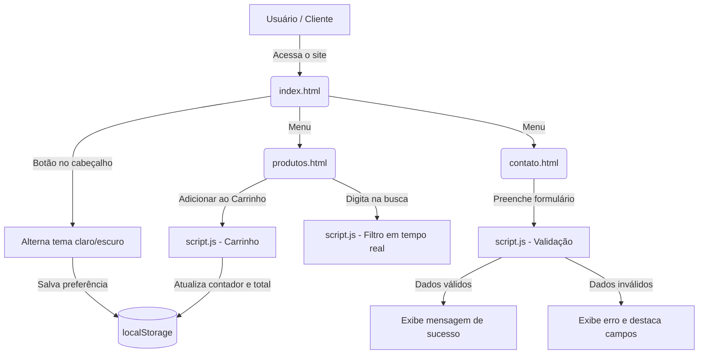
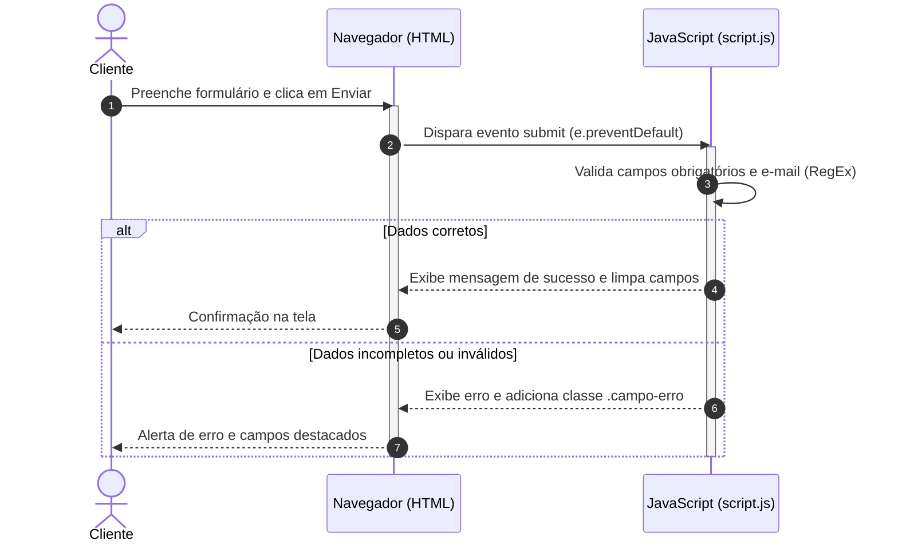
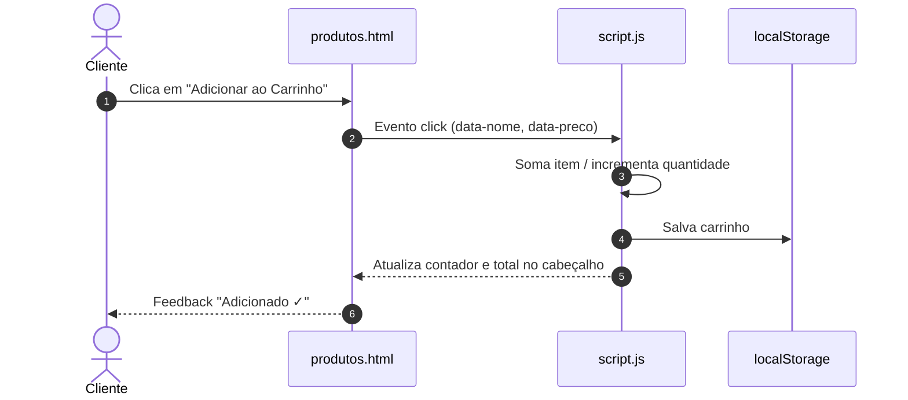

# 🌿 Beleza a Mais — Cuidados Pessoais & Bem-Estar

Projeto da disciplina de **Programação WEB** — Claretiano Centro Universitário (Análise e Desenvolvimento de Sistemas).
Loja fictícia de cosméticos de cuidados pessoais, evoluída em três etapas: **HTML → CSS → JavaScript + documentação (SAD)**.

---

## 📌 1. Proposta Visual

### Conceito da Loja

A **Beleza a Mais** é uma loja especializada em cosméticos de cuidados pessoais, autocuidado consciente e bem-estar (sabonetes artesanais, cremes hidratantes, sérum facial e óleos corporais). O objetivo visual é criar uma atmosfera de **acolhimento, tranquilidade e conforto**, reproduzindo a experiência relaxante de um spa botânico.

### Psicologia das Cores

- **Rosa Terracota Blush (`#C87A6D`):** carinho, sensibilidade e cuidado com a pele.
- **Verde Sálvia Botânico (`#5E7D63`):** ingredientes vegetais, sustentabilidade e frescor.
- **Fundo Areia / Creme (`#FAF6F3`):** descanso visual, destaque para fotos e informações.
- **Gradientes suaves:** banners, cartões e botões com acabamento moderno.

### Identidade Visual

Logotipo em monograma "B" serifado com acabamento rosé gold (`imagens/logo.svg`), compartilhando símbolo e paleta com o favicon (`imagens/favicon.svg`).

### Público-Alvo

Pessoas que valorizam rotinas de autocuidado e produtos de formulação vegetal, e que buscam uma navegação simples, agradável e responsiva.

---

## 🎨 2. Guia de Estilo

| Cor / Finalidade | HEX | Aplicação |
|:--|:--|:--|
| Primária (Terracota Blush) | `#C87A6D` | Logotipo, links ativos, títulos e botões |
| Primária Escura (Hover) | `#A6584C` | Hover de botões e links |
| Verde Sálvia | `#5E7D63` | Selos de destaque e sustentabilidade |
| Dourado Champagne | `#D4A373` | Detalhes do monograma |
| Fundo da Página | `#FAF6F3` | `body` |
| Branco Puro | `#FFFFFF` | Cartões e formulário |
| Bordas Delicadas | `#EADED7` | Divisores |
| Texto Principal | `#332924` | Textos com alto contraste |
| Texto Secundário | `#6E615A` | Descrições |
| Fundo do Rodapé | `#2B2420` | Rodapé |

**Tipografia:** títulos em `Georgia, 'Times New Roman', serif`; textos, menus e botões em `Arial, Helvetica, sans-serif`.

---

## 💻 3. Tecnologias Utilizadas

- **HTML5 semântico:** `<header>`, `<nav>`, `<main>`, `<section>`, `<article>`, `<footer>`, `<address>`, `<form>`.
- **CSS3 (`css/style.css`):** variáveis CSS, gradientes, Flexbox, media queries e tema escuro via `[data-theme="dark"]`.
- **JavaScript ES6+ (`js/script.js`):** manipulação do DOM, eventos, RegEx, `localStorage`.
- **Bootstrap 5 (CDN):** apenas no carrossel da página inicial.

---

## ⚡ 4. Interatividade com JavaScript

Todas as funcionalidades ficam em `js/script.js`, vinculado em cada página com:

```html
<script src="js/script.js" defer></script>
```

| Funcionalidade | Página | O que faz |
|:--|:--|:--|
| **Validação do formulário** | `contato.html` | Bloqueia envio com campos vazios (`preventDefault`), valida e-mail com RegEx, destaca campos com erro (`.campo-erro`) e mostra erro/sucesso em `#status-msg` sem recarregar a página. O `<form>` usa `novalidate` para que a validação seja feita pelo JS e não pelo navegador |
| **Contador de caracteres** | `contato.html` | Mostra `N/500` em tempo real no campo de mensagem |
| **Carrinho de compras** | `produtos.html` (contador em todas as páginas) | Botão "Adicionar ao Carrinho" (`data-add-carrinho`), contador `🛒 N` no menu, total em R$ e botão "Esvaziar", persistidos no `localStorage` |
| **Busca em tempo real** | `produtos.html` | Filtra os produtos por nome/categoria enquanto o usuário digita |
| **Tema claro/escuro** | Todas | Botão `#btn-tema` no menu que alterna `data-theme="dark"` no `<html>` e salva a preferência no `localStorage` (usa a preferência do sistema na primeira visita) |

---

## 📝 5. O que é Markdown e quem o criou?

**Markdown** é uma linguagem de marcação leve que permite formatar textos em texto puro usando símbolos simples (`#`, `*`, `**`, `` ` ``), tornando a leitura fácil e permitindo a conversão rápida para HTML.

Foi criada em **2004** por **John Gruber**, com a colaboração de **Aaron Swartz**, com o objetivo de permitir que pessoas escrevessem textos formatados para a web de forma simples e legível.

## 🏛️ 6. O que é SAD (Software Architecture Document)?

**SAD** (*Software Architecture Document*, ou Documento de Arquitetura de Software) é um documento da engenharia de software que descreve a arquitetura geral de um sistema. Ele apresenta as visões estruturais, componentes, fluxos de dados, módulos e decisões técnicas, servindo como guia para desenvolvedores e mantenedores do projeto.

## 🧜 7. O que é Mermaid.js?

**Mermaid.js** é uma biblioteca baseada em JavaScript que usa sintaxe inspirada em Markdown para renderizar diagramas, fluxogramas e gráficos dinamicamente no navegador ou em editores de texto.

### Ferramentas para criar e testar diagramas

1. **Mermaid Live Editor (oficial):** <https://mermaid.live>: edição em tempo real e exportação em PNG/SVG.
2. **Mermditor:** <https://www.mermditor.dev/editor>: editor leve com pré-visualização instantânea.
3. **Mermaid Chart:** <https://www.mermaidchart.com>: plataforma colaborativa com templates e integração com IDEs.
4. **Extensões do VS Code:** *Markdown Preview Mermaid Support* e *Mermaid Preview*.
5. **GitHub e GitLab:** renderizam nativamente blocos ```` ```mermaid ```` no `README.md`.

---

## 📊 8. Arquitetura do Sistema (SAD)

### 8.1 Fluxo de navegação e interatividade



### 8.2 Sequência de validação do formulário de contato



### 8.3 Sequência do carrinho de compras



---

## 🧩 9. Especificação de Componentes e Matriz de Responsabilidade

### a) Componentes do sistema

| Componente / Arquivo | Camada (SAD) | Tecnologia | Responsabilidade principal |
|:--|:--|:--|:--|
| **`index.html`** | Apresentação (View) | HTML5 + Bootstrap | Página inicial: carrossel de destaques e "Sobre Nós"; menu com tema e contador do carrinho |
| **`produtos.html`** | Apresentação (View) | HTML5 | Vitrine dos produtos com botões de carrinho e busca |
| **`contato.html`** | Apresentação (View) | HTML5 | Formulário de dúvidas e feedback, dados institucionais e mapa |
| **`css/style.css`** | Estilização (Style) | CSS3 | Identidade visual, cores, tipografia, Flexbox, responsividade e tema escuro |
| **`js/script.js`** | Lógica e Interatividade (Controller) | JavaScript (ES6+) | Eventos do DOM, validação (RegEx), carrinho, busca e alternância de tema |
| **`README.md`** | Documentação técnica | Markdown & Mermaid | Documentação, conceitos de SAD e diagramas |

### b) Matriz de responsabilidade por funcionalidade

| Requisito / Funcionalidade | HTML | CSS | JS | README |
|:--|:--:|:--:|:--:|:--:|
| Estrutura semântica e navegação | **Principal** | Suporte (menu/layout) | — | — |
| Design responsivo e estilização | Suporte (classes/IDs) | **Principal** | Suporte (troca de classes) | — |
| Validação de formulários (campos e RegEx) | Suporte (inputs/forms) | Suporte (estilos de erro) | **Principal** | — |
| Alternância de tema (Dark / Light) | Suporte (botão) | Suporte (variáveis CSS) | **Principal** (lógica/storage) | — |
| Carrinho de compras e busca | Suporte (botões/badge) | Suporte (feedback visual) | **Principal** (contador/total) | — |
| Documentação da arquitetura (SAD & Mermaid) | — | — | — | **Principal** |

---

## 📁 10. Estrutura de Pastas

```plaintext
PortifolioPW/
├── css/
│   └── style.css            # Estilos, variáveis, tema escuro e estilos da interatividade
├── js/
│   └── script.js            # Validação, carrinho, busca e alternância de tema
├── imagens/
│   ├── favicon.svg          # Ícone da aba (monograma B)
│   ├── logo.svg             # Logotipo vetorial oficial
│   ├── sabonete-vegetal.png
│   ├── serum-facial.png
│   ├── creme-corporal.png
│   ├── oleo-corporal.png
│   └── balsamo-labial.png
├── index.html               # Início: carrossel Bootstrap e Sobre Nós
├── produtos.html            # Vitrine com busca e carrinho
├── contato.html             # Formulário validado, dados institucionais e mapa
├── portifolio2.pdf          # Diretrizes da etapa anterior
└── README.md                # Documentação técnica (SAD)
```

---

## 🚀 11. Como Visualizar o Projeto

1. Abra o `index.html` em qualquer navegador (Chrome, Edge, Firefox…).
2. Use o botão **🌙 Escuro / ☀️ Claro** no menu para alternar o tema; a escolha é lembrada.
3. Em **Produtos**, busque por nome e adicione itens ao carrinho; o contador no cabeçalho é atualizado.
4. Em **Contato**, teste o formulário vazio, com e-mail inválido e com dados corretos, e acompanhe o contador de caracteres.
